<style>
img[alt~="center"] {
  display: block;
  margin: 0 auto;
}
a[href='red'] {
    color: red;
    pointer-events: none;
    cursor: default;
    text-decoration: none;
}
</style>

<style>
img[alt~="right"] {
  display: block;
  margin:auto;
}
a[href='red'] {
    color: red;
    pointer-events: none;
    cursor: default;
    text-decoration: none;
}
</style>


# **LLM智能应用开发**

第5讲: 大语言模型解析 II
基于HF LlaMA实现的讲解

RMSNorm and FFN

<!-- https://marp.app/ -->

---

# LLM结构的学习路径

* LLM结构解析(开源LlaMA)
* 自定义数据集构造
* 自定义损失函数和模型训练/微调

---

# Decoder-only：归一化与 FFN 的位置

<!--  -->


* 图中为 Llama 的 Decoder-only 结构
* 输入部分
  * Input embedding
  * Positional embedding
* **Transformer部分**
  * **Attention module**
  * **Feed forward network**

---

# HF LlaMA模型结构

```python
LlamaForCausalLM(
  (model): LlamaModel(
    ...
    (layers): ModuleList(
      (0-15): 16 x LlamaDecoderLayer(
        (self_attn): LlamaAttention
        (mlp): LlamaMLP
        (input_layernorm): LlamaRMSNorm
        (post_attention_layernorm): LlamaRMSNorm
    )
    ...
  )
  (lm_head): Linear(in_features=2048, out_features=128256, bias=False)
)
```


---

# LlamaDecoderLayer内部结构

```python
(self_attn): LlamaAttention(
  (q_proj): Linear(in_features=2048, out_features=2048, bias=False)
  (k_proj): Linear(in_features=2048, out_features=512, bias=False)
  (v_proj): Linear(in_features=2048, out_features=512, bias=False)
  (o_proj): Linear(in_features=2048, out_features=2048, bias=False)
  (rotary_emb): LlamaRotaryEmbedding()
)
(mlp): LlamaMLP(
  (gate_proj): Linear(in_features=2048, out_features=8192, bias=False)
  (up_proj): Linear(in_features=2048, out_features=8192, bias=False)
  (down_proj): Linear(in_features=8192, out_features=2048, bias=False)
  (act_fn): SiLU()
)
(input_layernorm): LlamaRMSNorm((2048,), eps=1e-05)
(post_attention_layernorm): LlamaRMSNorm((2048,), eps=1e-05)
```

---

# LlamaDecoderLayer内部结构

* Normalization模块
  * LlamaRMSNorm
* 两个主要模块
  * LlamaAttention
  * FFN（代码类名 `LlamaMLP`）

FFN（前馈网络）是 Transformer 中的子层，通常由 MLP（多层感知机）实现。
本讲统一称 FFN，代码中保留 `LlamaMLP` 和 `mlp` 的真实名称。


---

# Normalization

```python
(input_layernorm): LlamaRMSNorm
```

* Normalization，中文又称“归一化”，“标准化”,... 
* 作用：调整数据的分布(scaling)，亦可称“缩放”
*  数据包括：输入、输出、中间层表示，...

<div style="display:contents;" data-marpit-fragment>

最经典的Normalization

Standard score: $\frac{X-\mu}{\sigma}$, Minmax feature scaling: $\frac{X-X_{\min}}{X_\max-X_{\min}}$

</div>

---

# Normalization示例

<div style="display:contents;" data-marpit-fragment>


一维的输入，归一化后的输出
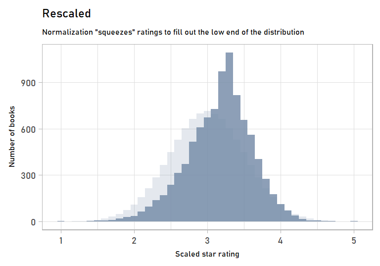

</div>

---

# 归一化如何帮助优化

<style scoped>
section { padding: 40px 60px; }
p { margin: 12px 0; }
.figure-caption { font-size: 24px; }
</style>

对输入特征做尺度调整，有助于改善优化条件。

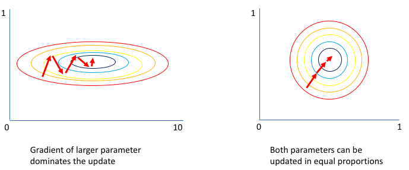

<p class="figure-caption">图中展示参数空间的优化轨迹；输入缩放的效果仅作示意。</p>

**“更容易优化”，就一定“更不容易过拟合”吗？**

<!-- 此页讲输入特征缩放对参数优化的直觉，不是直接对参数做 norm，也不是 RMSNorm 让损失曲面变圆的证明。原图“较大参数梯度主导”应口头解释为不同方向优化条件不均衡，不能以参数大小推断梯度大小。结尾问题引出下一页的优化与泛化目标区别。 -->

---

# Normalization 与 Regularization

前一页讨论**优化是否容易**；还要区分**泛化是否可靠**。

- **归一化**：调整输入或激活的尺度，帮助稳定计算与优化。
- **正则化**：通过约束、惩罚或随机化等方式，控制过拟合。

例如，损失惩罚是正则化的一种形式：

$$\mathcal{L}(\theta)=\sum_{i=1}^N L(f_\theta(x_i),y_i)+\lambda R(\theta)$$

归一化也可能影响泛化，但不能据此将它等同于正则化。

<!-- 两者的效果可能交叉，此处区分主要作用机制，不应把“优化”与“泛化”讲成互斥。正则化不只限于修改损失函数，例如 dropout 采用随机化。下一页开始讨论模型内部 hidden activations 的归一化。 -->

---

# 大语言模型引入Normalization

Normalization：“调整数据分布”

* 数据长什么样子？都是tensor！维度很多！
  * 原始输入: vocab embedding
    * tensor shape: <batch_size, sequence_length, hidden_dim>
  * 深度学习模型中间层表示(hidden states/representations)
      * tensor shape: <batch_size, sequence_length, hidden_dim>

---

# Normalization案例


<div style="display:contents;" data-marpit-fragment>

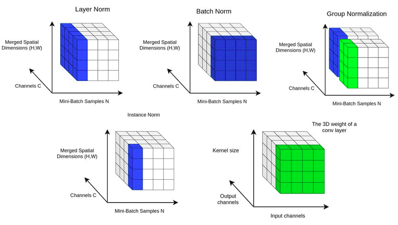

</div>

---

# Normalization 的统计范围

输入 $X$ 的形状为 $[B,S,H]$：batch、token 位置、hidden 特征。

- 固定 $b,s$，对向量 $X[b,s,:]$ 的 $H$ 个特征计算统计量。
- 不混合其他样本，也不跨整段序列统计。
- LayerNorm 与 RMSNorm 的计算范围相同，使用的统计量不同。

```text
输入 X       [B, S, H]
统计量       [B, S, 1]   ← 沿 hidden 维，keepdim=True
广播并缩放   [B, S, H]   ← 每个 token 使用自己的统计量
```

<!-- 对比：沿 batch 维归约会将不同样本混在一起；沿完整 sequence 维归约会让当前位置依赖其他位置，可能包含未来 token。当前 LLM LayerNorm(H)/RMSNorm(H) 均只沿 H 统计。参考 PyTorch LayerNorm 与 RMSNorm 官方文档。 -->

---

# LLM 中的 Normalization

<style scoped>
section { padding: 35px 52px; }
h1 { margin-bottom: 12px; }
p { margin: 12px 0; }
</style>

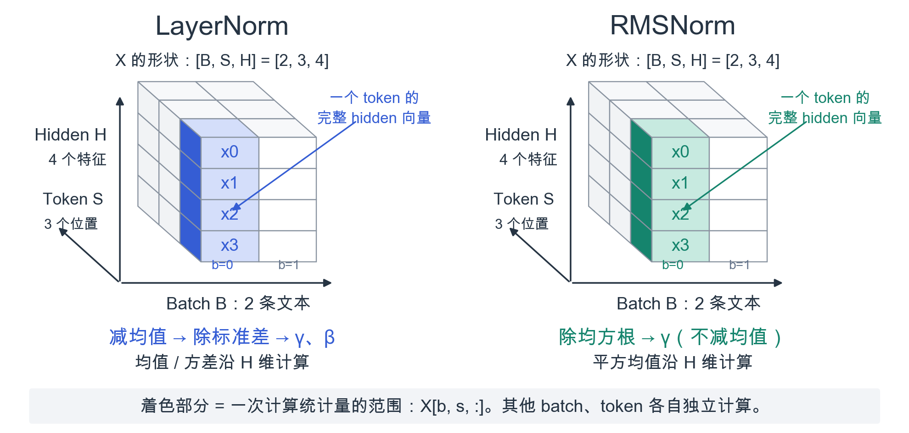

<!-- 延续原 CV 图的着色方式：横轴 B（文本样本）、斜轴 S（token 位置）、竖轴 H（hidden 特征）。着色竖条是 X[b,s,:]，一次统计只涉及这条向量。LN 与 RMSNorm 范围相同，统计量不同。公式中的分母实际包含 epsilon，gamma/beta 分别表示逐维缩放/偏移。 -->
---

# LayerNorm

* 针对每个token在hidden_dim维度上做标准化，避免依赖batch/序列长度
* 计算流程：
  * $\mu=\frac{1}{H}\sum_{i=1}^{H}x_i$
  * $\sigma^2=\frac{1}{H}\sum_{i=1}^{H}(x_i-\mu)^2$
  * $\hat{x}_i=\frac{x_i-\mu}{\sqrt{\sigma^2+\epsilon}}$
  * $y_i=\gamma_i\hat{x}_i+\beta_i$
* 可学习参数$\gamma,\beta$恢复尺度与偏移，保持表达能力
* 优势：序列自回归场景中激活分布更稳定，梯度更易传播

---

# RMSNorm

固定一个 token，记它的 hidden 向量为 $x\in\mathbb{R}^{H}$：

$$y_i=\gamma_i\frac{x_i}{\sqrt{\frac1H\sum_{j=1}^{H}x_j^2+\epsilon}}$$

- $H$ 为 hidden 维度，求和只涉及当前 token 的特征。
- $\gamma\in\mathbb{R}^{H}$ 是可学习的逐维缩放参数。
- 同一层的所有 batch、token 共享同一个 $\gamma$。
- $\epsilon$ 用于数值稳定；RMSNorm 不减去均值。

<!-- PyTorch 实现：torch.nn.RMSNorm(H)，https://pytorch.org/docs/stable/generated/torch.nn.RMSNorm.html -->


---

# 手搓 RMSNorm

$$y_i=\gamma_i\frac{x_i}{\sqrt{\frac1H\sum_{j=1}^{H}x_j^2+\epsilon}}$$

输入与输出：$[B,S,H]$。计算分成三步：

1. `x.square().mean(-1, keepdim=True)`：平方均值，形状 $[B,S,1]$。
2. `rsqrt(mean_square + eps)`：缩放系数，广播乘到 $H$ 个特征。
3. 逐维乘以 $\gamma$，形状 $[H]$，输出仍为 $[B,S,H]$。

这里 $H$ 始终表示 hidden 维度；batch 与 sequence 维保持不变。


---

# 编码实现 RMSNorm

<style scoped>

p { font-size: 28px; }
</style>

```python
x = torch.tensor([[[1., 2., 1., 2.], [2., 4., 2., 4.]]])
norm = nn.RMSNorm(4, eps=1e-6)
x32 = x.float()
mean_square = x32.square().mean(-1, keepdim=True)
y = (x32 * torch.rsqrt(mean_square + norm.eps)).to(x.dtype)
y = y * norm.weight

torch.testing.assert_close(y, norm(x))
```

`keepdim=True` 保留 `[b, s, 1]`，广播到各自的 4 个特征。
验证时统一 $\epsilon$ 和 $\gamma$；$\gamma$ 为可学习参数。

---

# 为什么选择 RMSNorm？

<style scoped>
p, li { font-size: 30px; }
table { font-size: 28px; }
</style>

两者都用于控制每个 token 的激活尺度，但处理方式不同：

| 方法 | 中心化 | 尺度调整 |
|---|---|---|
| LayerNorm | 减去均值 | 除以标准差，再学习缩放与偏移 |
| RMSNorm | 不减均值 | 除以均方根，再学习缩放 |

- **计算更简单**：省去减均值及相关计算。
- **效果与成本的取舍**：原论文在所测任务中取得相近效果，Llama 采用这一设计。
- 这不意味着 LayerNorm 失效；均值并非永远不重要，速度收益依赖实现和硬件。

<!-- 依据：Root Mean Square Layer Normalization，https://arxiv.org/abs/1910.07467。论文结果不应泛化为所有模型、任务或现代内核的固定加速比例。Llama pre-norm 分支采用 RMSNorm。 -->

---

# Attention 后，为什么还有 FFN？

<style scoped>

p, li { font-size: 30px; }
</style>

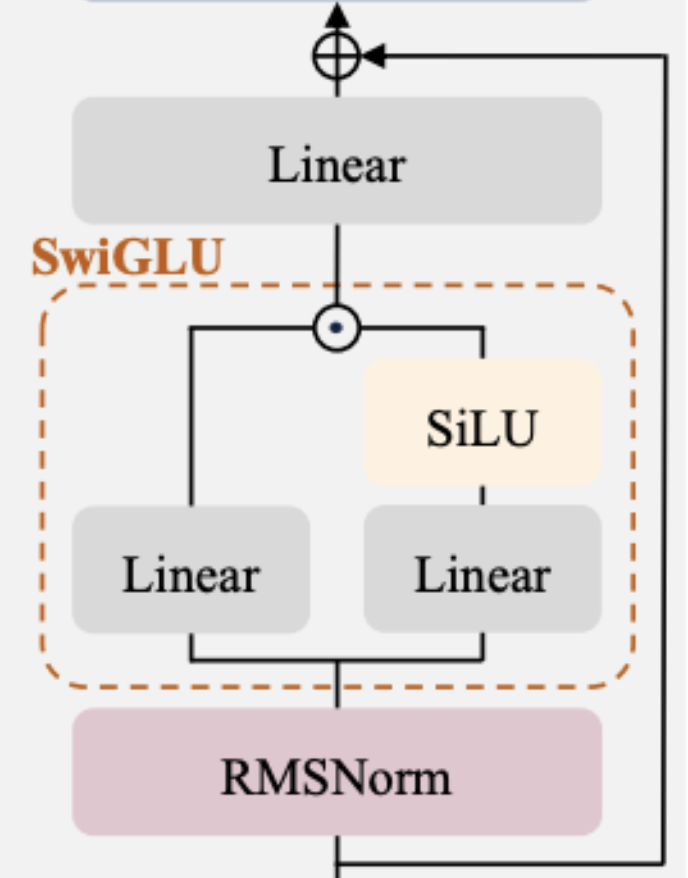

Attention 让当前位置从其他 token 获取上下文。
FFN 接着对这个位置的表示做**非线性特征加工**。

- Attention：跨 token 汇聚与交互。
- FFN：在每个 token 内组合、调节特征。
- 同一层的 FFN 参数在所有位置共享。

例如“我不喜欢这部电影”：汇聚“**不**”的信息后，
当前位置还需要把这些特征组合成有用的更新。

<!-- 语义例子仅用于直觉：不表示某个神经元必然对应“否定”或“喜欢”。Attention 自身也包含特征投影与 softmax 非线性；这里强调分工，不能讲成 attention 只搬运数据。参考 Attention Is All You Need §3.3：https://arxiv.org/html/1706.03762v7#S3.SS3 -->

---

# 升维：展开特征组合

<style scoped>

p, li { font-size: 29px; }
</style>

单个 token 的表示：$h\in\mathbb{R}^{H}$，映射到 $F$ 个中间特征，通常 $F>H$。

$$u=W_u h\qquad H\longrightarrow F$$

- 每个中间单元都有一组权重，学习一种特征组合。
- 例如从 $(a,b)$ 构造 $a+b$、$a-b$ 等不同响应。
- 升维提供更宽的计算空间；非线性进一步加工这些响应。

若只做线性升维再降维：$W_d(W_uh)=(W_dW_u)h$，
仍等价于一个线性层。**表达能力来自宽度与非线性的结合。**

<!-- 升维不增加输入的信息量；更长的向量也不保证效果更好。示例中的 a+b、a-b 是手工组合，真实权重通过训练学习。这里的线性合并结论只针对连续线性投影，不包括两个输入相关分支的逐元素乘法。 -->

---

# 门控：按当前输入调节中间特征

<style scoped>

p, li { font-size: 29px; }
pre { font-size: 26px; }
</style>

Llama 的 SwiGLU 有两条升维分支：

$$u=W_uh,\quad g=\operatorname{SiLU}(W_gh),\quad z=g\odot u$$

`up_proj` 产生候选特征，`gate_proj` 根据当前 $h$ 产生调节系数。

```text
候选特征 u     [ 2,  -1,  3 ]
门控系数 g     [ 0, 0.5,  2 ]   ← 示意值
逐元素相乘 z   [ 0, -0.5,  6 ]
```

系数接近 0 时抑制该特征，大于 1 时放大。
SiLU 的输出也可为负；它不是 0/1 开关或概率。

<!-- 这是输入相关的逐维调节；不同 token 使用同一组投影参数，但计算出的门值不同。参考 GLU Variants Improve Transformer：https://arxiv.org/html/2002.05202v1 -->

---

# 降维与残差

<style scoped>
section { padding: 36px 60px; }

p { font-size: 24px; margin: 12px 0; }
</style>


$W_d\in\mathbb{R}^{H\times F}$ 将 $F$ 个中间特征加权组合成 $H$ 维更新：

$$\Delta_{\mathrm{FFN}}=W_dz,\qquad
(\Delta_{\mathrm{FFN}})_k=\sum_{j=1}^{F}W_{d,kj}z_j$$

降维是可学习的组合；输出回到 hidden 维，才能与主干相加。

$$
\begin{aligned}
t &= x+\operatorname{Attention}(\operatorname{Norm}_1(x))\\
h &= \operatorname{Norm}_2(t)\\
z &= \operatorname{SiLU}(W_gh)\odot(W_uh)\\
y &= t+\Delta_{\mathrm{FFN}}
\end{aligned}
$$

**$t$ 是保留的主干表示，$h$ 是交给 FFN 的归一化输入。**
图中上方 Linear 输出 $\Delta_{\mathrm{FFN}}$，旁路保留 $t$，顶端相加得到 $y$。

<!-- Llama pre-norm decoder block：t 是第一次残差后的表示，h 是 Norm2(t)，z 是门控后的中间特征；Delta_FFN 的命名强调更新量，不意味着 h 与 y 直接相减。全程 batch、sequence 不变。公式使用列向量；PyTorch Linear 对应 z @ W_d.T。 -->

---

# FFN实现，LlamaMLP

```python
(mlp): LlamaMLP(
  (gate_proj): Linear(in_features=2048, out_features=8192, bias=False)
  (up_proj): Linear(in_features=2048, out_features=8192, bias=False)
  (down_proj): Linear(in_features=8192, out_features=2048, bias=False)
  (act_fn): SiLU()
)
```

* 组件：三个nn.Linear层，一个SiLU激活函数
  * SiLU: torch.nn.functional.silu(x)
  * Linear: torch.nn.Linear(in_features, out_features)


---

# FFN流程

* 输入tensor: <batch_size, sequence_length, hidden_dim>
* 第一步：
  * 通过gate_proj获得gate tensor，经过SiLU激活得到gate tensor
  * 通过up_proj获得up tensor
* 第二步：元素乘(elementwise multiply): gate tensor 和 up tensor
* 第三步: 通过down_proj获得down tensor

---

# 激活函数(引入非线性)


* 通过引入非线性函数(nonlinear function)可增加模型非线性的能力，在模型中，也称之为激活函数
  * 线性层: $x=f(x)=xW^\top+b$
  * 激活:   $x=activation(x)$
* activation类型
  * ReLU、Sigmoid、SiLU 等；SwiGLU 是含 SiLU 的门控模块。

---

# 经典激活函数

* Sigmoid：$\sigma(x)=\frac{1}{1+e^{-x}}$，输出压缩到$(0,1)$，常用于概率建模
* Tanh：$\tanh(x)=\frac{e^{x}-e^{-x}}{e^{x}+e^{-x}}$，零均值输出缓解偏置，会出现梯度消失
* ReLU：$\operatorname{ReLU}(x)=\max(0,x)$，计算高效
* Leaky ReLU：$\max(\alpha x, x)$ with $\alpha\approx 0.01$，为负半轴保留小梯度
<!-- * SiLU：$x\cdot\sigma(x)$，兼具平滑和门控性质，常作为SwiGLU中的激活 -->

---

# 激活函数(引入非线性)

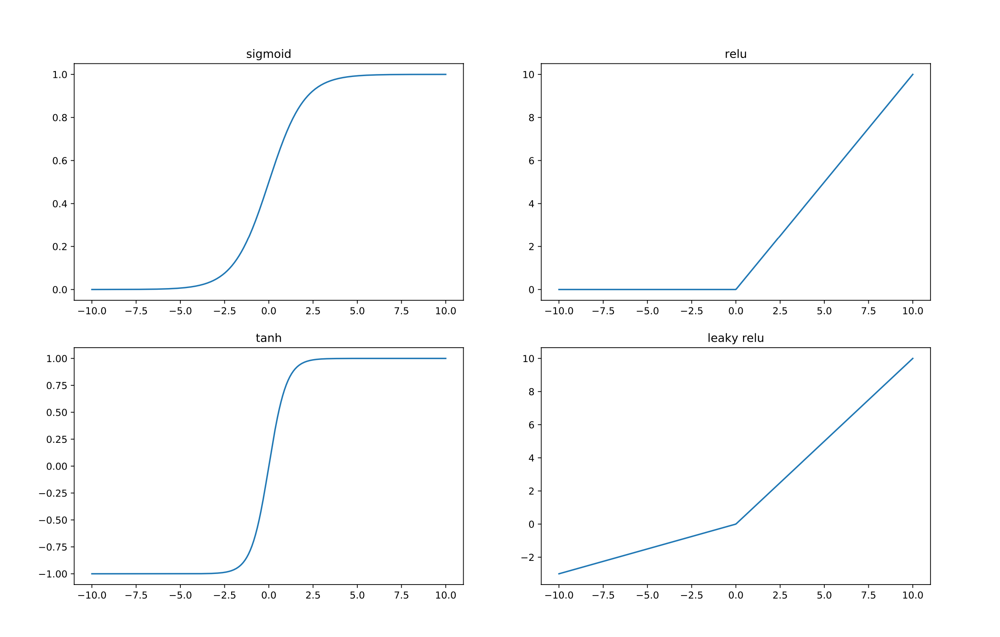


---

# 激活函数(引入非线性)

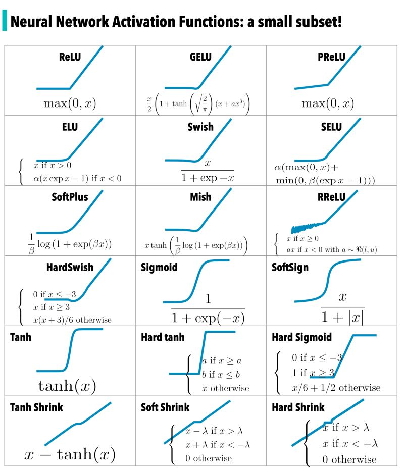


---


# SwiGLU FFN：门控与参数量

* 门控分支：$g=\operatorname{SiLU}(W_gx)$。
* 候选分支：$u=W_ux$。
* 逐元素相乘，再投影回 hidden 维：$y=W_d(g\odot u)$。
* SiLU：$\operatorname{SiLU}(z)=z\cdot\sigma(z)$。
* 不同于概率门控，SiLU 的输出不限于 $(0,1)$。

隐藏维度为 $H$、中间维度为 $F$ 时（忽略 bias）：
三次线性映射约有 $3HF$ 个参数；普通两层 FFN 约为 $2HF$。

比较参数开销时，需要同时说明中间维度。

---

# SwiGLU FFN 的前向实现

<style scoped>

p { font-size: 26px; margin: 12px 0; }
</style>

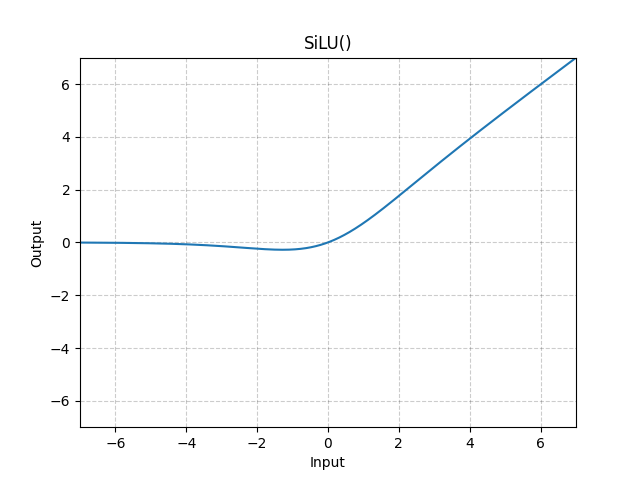

上图是 SiLU 激活曲线；下面是完整 SwiGLU FFN 的前向计算。

```python
down_proj = self.down_proj(self.act_fn(self.gate_proj(x)) * self.up_proj(x))
```

---

# 补充：RoPE 实现

<style scoped>
section { padding: 36px 60px; }

p { font-size: 28px; margin: 12px 0; }
</style>

RoPE的2D实现（相邻维度配对）
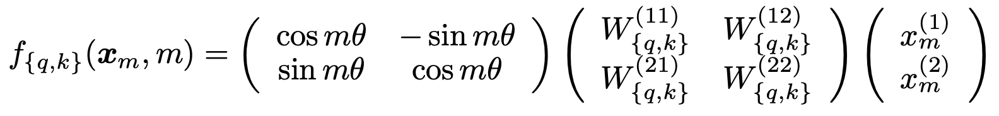

RoPE的n维实现
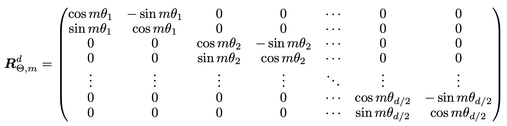


---

# RoPE公式

* 基础频率：$\theta_i = \text{base}^{-2i/d}$，常用$\text{base}=10000$
* 位置角度：$\theta_{m,i} = m\,\theta_i$，其中$m$为token位置，$i$为维度对索引
* 旋转变换：
  * $x'_{2i} = x_{2i}\cos\theta_{m,i} - x_{2i+1}\sin\theta_{m,i}$
  * $x'_{2i+1} = x_{2i}\sin\theta_{m,i} + x_{2i+1}\cos\theta_{m,i}$
* 可写成$2\times2$旋转矩阵：$\mathbf{x}'_{i} = R(\theta_{m,i})\,\mathbf{x}_{i}$，保持范数不变


---

# RoPE实现

* 目标：实现RoPE(对应的$R_{\Theta, m}^d$)
  * 准备一堆$\theta_{n,i}$，以及对应的cos和sin数值

* 构建RoPE矩阵: $R_{\Theta, n}^d$流程
  * 批量算cos，再批量算sin
  * 涉及torch算子
    * torch.arange, torch.sin, torch.cos, torch.outer

---

# RoPE高效实现

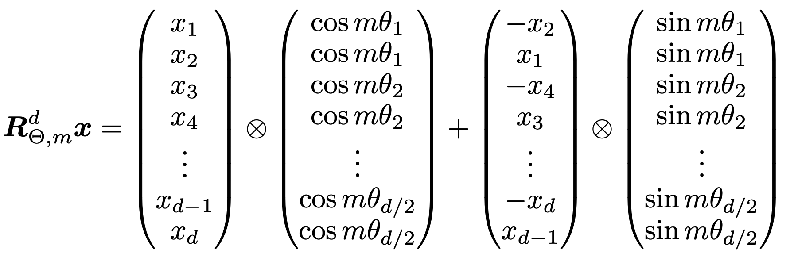

---

# RoPE高效实现

<style scoped>
section { padding: 38px 65px; }

p { font-size: 28px; margin: 12px 0; }
pre { font-size: 24px; margin: 16px 0; }
</style>

Llama 使用前后半维配对：$(x_i,x_{i+d/2})$；cos/sin 也按同样布局复制。

```python
def rotate_half(x):
    x1, x2 = x.chunk(2, dim=-1)
    return torch.cat((-x2, x1), dim=-1)
```
```python
def apply_rotary_pos_emb(q, k, cos, sin):
    # q/k: [b, s, h, d]; cos/sin: [s, d]
    cos = cos[None, :, None, :]
    sin = sin[None, :, None, :]
    q_embed = (q * cos) + (rotate_half(q) * sin)
    k_embed = (k * cos) + (rotate_half(k) * sin)
    return q_embed, k_embed

```
