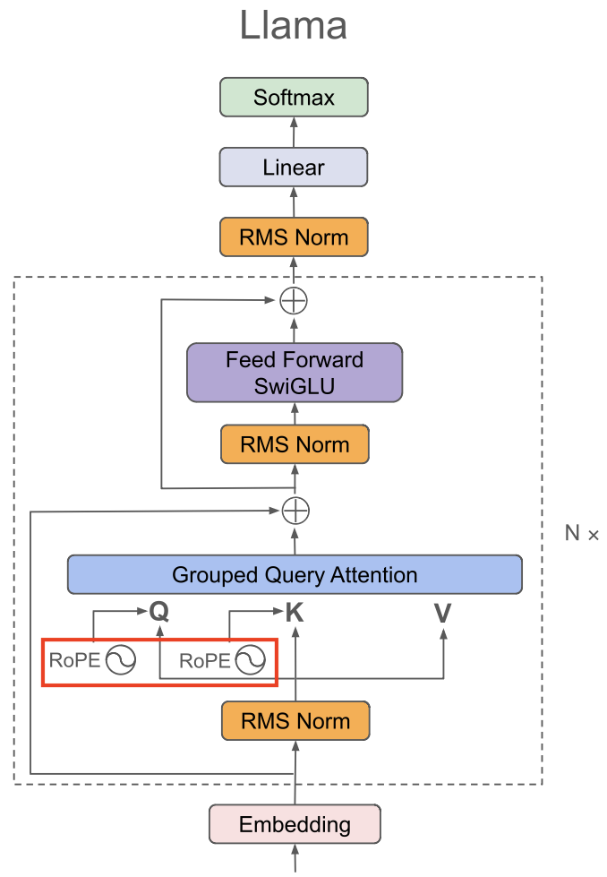
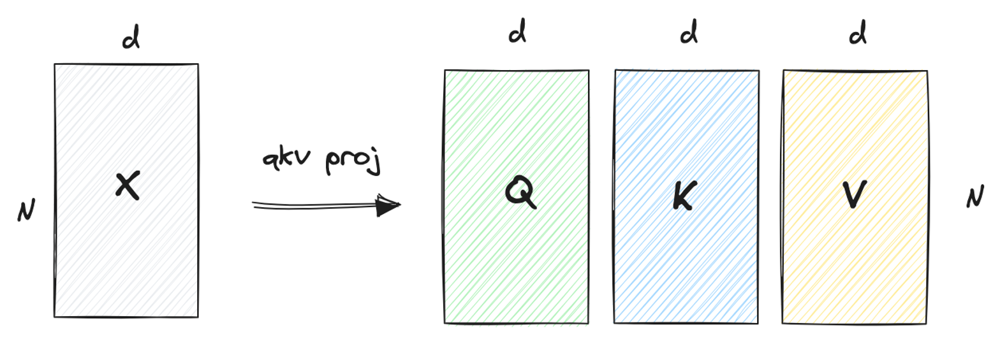
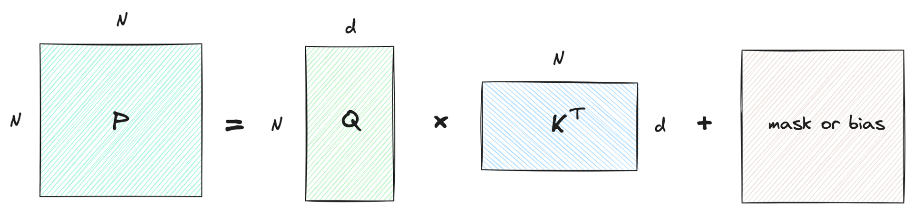
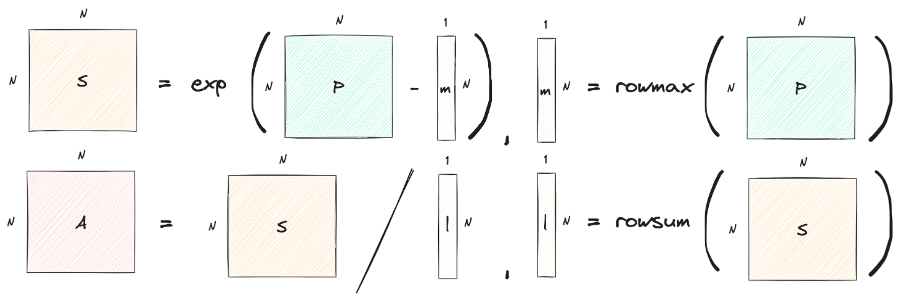
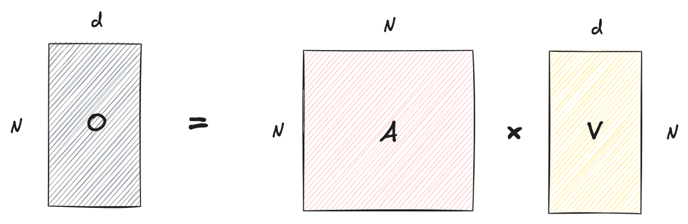

<style>
img[alt~="center"] {
  display: block;
  margin: 0 auto;
}
.qkv-code ul { list-style: none; padding: 0; margin: 0; }
.qkv-code li { margin: 0; }
.qkv-code code { display: block; border-radius: 0; padding: 0 0.5em; }
.qkv-code { margin: 0.5em 0; }
.reveal-block > ul { list-style: none; padding: 0; }
.reveal-block > ul > li { margin: 0; }
a[href='red'] {
    color: red;
    pointer-events: none;
    cursor: default;
    text-decoration: none;
}
</style>

<style>
img[alt~="right"] {
  display: block;
  margin:auto;
}
a[href='red'] {
    color: red;
    pointer-events: none;
    cursor: default;
    text-decoration: none;
}
</style>


# **LLM智能应用开发**

第6讲: 大语言模型解析 III
基于HF LlaMA实现的讲解

Attention Mechanism I
<!-- https://marp.app/ -->


---

## 本讲目标：从 hidden states 到 Attention 输出

* 写出带 causal mask 的多头 Attention
* 跟踪每一步的张量维度，理解每个头如何聚合上下文
* 解释 Llama 中 Q 与 K/V 投影宽度为何不同
* 理解分块计算中的归一化约束与中间矩阵存储

---

## Decoder-only：Attention 位于哪里？



* Llama 使用 Decoder-only 结构
* Attention 让不同位置交换信息
* Pre-norm：Attention 接收归一化后的 hidden states
* RoPE 作用于分头后的 Q、K

---

## Attention 模块与 Attention 运算

* 模块输入：hidden states $X$，shape 为 $[B,S,H]$
* 模块包含 `q_proj`、`k_proj`、`v_proj`、`o_proj`
* 核心运算接收投影后的 $Q,K,V$：

<div class="reveal-block">

* $$\operatorname{Attention}(Q,K,V)=\operatorname{softmax}\!\left(\operatorname{mask}\!\left(\frac{QK^\top}{\sqrt{d_k}}\right)\right)V$$


</div>

* $B$：batch size；$S$：sequence length；$H$：hidden size
* $d_k$：每个头的 Q/K 维度；mask 用于限制可访问的位置

---

## 第一步：从 $X$ 投影得到 $Q,K,V$

* 单头教学例子：$X,Q,K,V$ 都为 $[B,S,H]$，$d_k=H$
* $Q=XW_Q$，$K=XW_K$，$V=XW_V$
* 此处 $W_Q,W_K,W_V$ 均为 $[H,H]$

<div class="qkv-code">

* `q = q_proj(hidden_states)`
* `k = k_proj(hidden_states)`
* `v = v_proj(hidden_states)`

</div>

* 数学约定：$XW$；PyTorch `Linear` 计算 `X @ weight.T`
* `Linear.weight` 存储为 `[out_features, in_features]`

---

## 展平 batch 与序列维展示 QKV 投影

* 将 $X$ 从 $[B,S,H]$ 展平为 $[N,H]$，其中 $N=B\times S$，图中 $d=H$
* QKV 线性投影逐 token 独立执行，展平不改变计算结果
* 后续按 $[B,S,H]$ 计算 Attention，分数矩阵为 $[B,S,S]$，各样本独立

<div class="reveal-block">

* 


</div>

---

## 第二步：计算相关性分数 $P$

* $P=QK^\top/\sqrt{d_k}+M$，shape 为 $[B,S,S]$
* 每个样本内：行对应 Query，列对应 Key；下图中 $N=S$
* $M_{ij}=0$ 表示允许，$M_{ij}=-\infty$ 表示屏蔽
* 缩放因子用于控制点积随维度增长的幅度

<div class="reveal-block">

* 


</div>

---

## 第二步：引入 Causal Mask

* $M$ 为加性 mask：允许访问的位置取 $0$，屏蔽的位置取 $-\infty$
* 自回归模型中，位置 $i$ 只能访问位置 $j\le i$
* 4-token 例子的加性 mask：

<div class="reveal-block">

* $$M=\begin{bmatrix}
  0&-\infty&-\infty&-\infty\\
  0&0&-\infty&-\infty\\
  0&0&0&-\infty\\
  0&0&0&0
  \end{bmatrix}$$

</div>

* 将未来位置的 score 填为 $-\infty$，softmax 后其权重为 0
* 保留对角线：当前位置可以访问自己

---

## Padding mask：排除补齐位置

* `<PAD>` 用于把不同长度的序列补齐为同样长度
* Key padding mask 屏蔽补齐位置对应的列，避免读取无效内容
* 与 causal mask 合并：任一规则禁止访问，就将 score 设为 $-\infty$
* 有效 Query 行至少保留一个 Key；整行都是 $-\infty$ 时，普通 softmax 会产生 NaN
* Padding 的 Query 输出还需在后续使用或 loss 中忽略

---

## 第三步：沿 Key 维度做 Softmax

* $A=\operatorname{softmax}(P,\mathrm{dim}=-1)$，shape 为 $[B,S,S]$
* 对每一行 $i$：$m_i=\max_j P_{ij}$，$l_i=\sum_j e^{P_{ij}-m_i}$
* $A_{ij}=e^{P_{ij}-m_i}/l_i$；图中的矩阵 $S$ 表示指数项
* 每个有效行的权重和为 1；被屏蔽位置的权重为 0

<div class="reveal-block">

* 


</div>

---

## 第四步：用权重聚合 Value

* $O=AV$，shape 为 $[B,S,H]$
* $O_i=\sum_j A_{ij}V_j$：每个查询位置得到一个上下文向量
* $A$ 是注意力权重，$O$ 才是核心 Attention 运算的输出

<div class="reveal-block">

* 


</div>

---

## Notebook 1–2：单头 Attention 与因果性

* 顺序观察 $Q,K,V\rightarrow P\rightarrow A\rightarrow O$ 的 shape
* 手写稳定 softmax，与 `torch.softmax` 对齐
* 打印 4-token 的权重矩阵：上三角为 0，每行和为 1
* 实验：只改变最后一个 token，前三个位置的输出应保持不变
* 再改变另一个 batch 样本，检查当前样本输出不变

<div class="reveal-block">

* 思考：去掉 causal mask，前一个实验还成立吗？


</div>

---

## Multi-Head Attention：多个学习到的子空间

* 每个头使用不同的 Q/K/V 投影分量，形成自己的注意力权重
* 将特征拆成 $h$ 个头，$H=h\,d_h$（$H$ 是 hidden size，$h$ 是头数）
* 每个头独立计算：$O_r=\operatorname{Attention}(Q_r,K_r,V_r)$
* 将各头输出拼接后，用 $W_O$ 混合信息：

<div class="reveal-block">

* $$Y=\operatorname{Concat}(O_1,\ldots,O_h)W_O$$


</div>

* 多头不是复制同一份 Q/K/V；各头对应投影矩阵的不同列

---

## MHA 的完整张量路径

<div class="reveal-block">

* | 步骤 | Shape |
  |---|---|
  | 输入与 Q/K/V 投影 | $[B,S,H]$ |
  | `view` 后 | $[B,S,h,d_h]$ |
  | `transpose(1, 2)` 后 | $[B,h,S,d_h]$ |
  | score 与注意力权重 | $[B,h,S,S]$ |
  | 每个头的输出 | $[B,h,S,d_h]$ |
  | 转置、拼接、`o_proj` 后 | $[B,S,H]$ |

</div>

* 每头使用 $\sqrt{d_h}$ 缩放；softmax 沿最后一维执行

---

## Llama：为什么 K/V 比 Q 窄？

* 一种 Llama 配置的投影结构（具体尺寸依模型配置而定）：

<div class="reveal-block">

* ```python
  q_proj: Linear(2048, 2048, bias=False)
  k_proj: Linear(2048,  512, bias=False)
  v_proj: Linear(2048,  512, bias=False)
  o_proj: Linear(2048, 2048, bias=False)
  ```

</div>

* 假设 $d_h=64$：Q 有 32 个头，K/V 各有 8 个头
* 每 4 个 Query 头共享一个 K 头和一个 V 头
* 这就是 Grouped Query Attention（GQA）

---

## MHA、GQA、MQA：共享程度不同

<div class="reveal-block">

* | 形式 | Query 头数 $h$ | KV 头数 $g$ | 共享关系 |
  |---|---:|---:|---|
  | MHA | 8 | 8 | 每个 Q 头有对应的 K/V 头 |
  | GQA | 8 | 2 | Q₀–Q₃ → KV₀；Q₄–Q₇ → KV₁ |
  | MQA | 8 | 1 | 所有 Q 头 → KV₀ |

</div>

* Q 投影输出宽度为 $h\,d_h=H$；K/V 各为 $g\,d_h$
* $h$ 必须能被 $g$ 整除，每组包含 $h/g$ 个 Query 头
* 配置字段：`num_attention_heads`、`num_key_value_heads`

---

## GQA 节省的是哪些资源？

* 每层、每个 token 的 K 与 V 合计：从 $2h\,d_h$ 降至 $2g\,d_h$ 个元素
* 缓存元素数：$2BSg\,d_h$；字节数还需乘以每元素字节数
* 相对 MHA，KV cache 大小变为 $g/h$，K/V 投影也变窄
* 注意力仍有 $h$ 个 Query 头；score 计算量不会自动变为 $g/h$
* 吞吐收益依赖上下文长度、硬件与实现；不同型号应查看配置
* $g$ 越小，共享越多，表达能力与速度的取舍需训练和评估

---

## Notebook 3–4：MHA 与 GQA

* 跟踪分头、转置、拼接与输出投影的完整过程
* 对照 PyTorch SDPA 检查 MHA 数值结果
* 统计未扩展的 K 和 V，核对 GQA 缓存缩减比例
* 教学代码用 `repeat_interleave` 显式复制 KV，便于对应 Query 头
* 缓存保留 $g$ 个头；实际内核可直接共享 KV，避免显式复制

<div class="reveal-block">

* 思考：KV 头数减少后，输出的 hidden size 是否改变？


</div>

---

## Attention 的计算与存储开销

* 记 $H=h\,d_h$；下面讨论 $QK^\top$ 和 $AV$，不含投影层
* 两次矩阵乘法各为 $O(BhS^2d_h)=O(BS^2H)$
* 固定 $H$ 时，多头不会使这部分计算量直接增加 $h$ 倍
* 显式保存注意力权重需要 $O(BhS^2)$ 个元素
* 当序列长度加倍，以上计算量和权重存储约增至 4 倍

<div class="reveal-block">

* 问题：能否避免一次保存整个 $S\times S$ 的中间矩阵？


</div>

---

## 分块计算：先固定一块 Query

* 取一个样本的一个头：$Q,K,V\in\mathbb{R}^{S\times d_h}$
* 取 $b_q$ 行 Query，与各块 Key 计算分数
* 教学实现先拼接该 Query 块的全部 score，shape 为 $[b_q,S]$
* 沿整行做 softmax，再与完整的 V 相乘，得到 $[b_q,d_h]$
* 循环处理所有 Query 块，输出与标准 Attention 数值一致


---

## 为什么不能每块单独做 Softmax？

* 一行 score 为 $[0,0,0,0]$，整行 softmax 为 $[1/4,1/4,1/4,1/4]$
* 若切成两块并各自归一化，拼起来得到 $[1/2,1/2,1/2,1/2]$
* 分母必须包含该 Query 能访问的所有 Key
* 当前 notebook 拼接完整 score 行后再归一化，保证正确性
* Python 分块示例用于验证等价性，不代表 GPU 加速效果
* 训练时 autograd 还可能保留各块中间量，不能据此推断训练显存收益

---

## 不保存整行，也能得到输出吗？

* 上述分块实现仍需生成 $b_q\times S$ 的 score 与权重
* Attention 最终需要的是加权和 $O$，不一定要保存完整的 $A$
* 能否边读新的 K/V 块，边更新归一化因子与加权和？
* 若运行中的最大值改变，旧的累积量也需要重新缩放


---

## 本讲检查：你能解释这四件事吗？

1. 为什么 batch 样本不能互相做 Attention？
2. 为什么修改未来 token 不影响前面位置的输出？
3. MHA 分头后，softmax 沿哪个维度？缩放因子是什么？
4. GQA 为什么能缩小 KV cache，却保持输出为 $[B,S,H]$？

课后：用 notebook 完成带 causal mask 的 MHA，并核对输出与参考实现。
