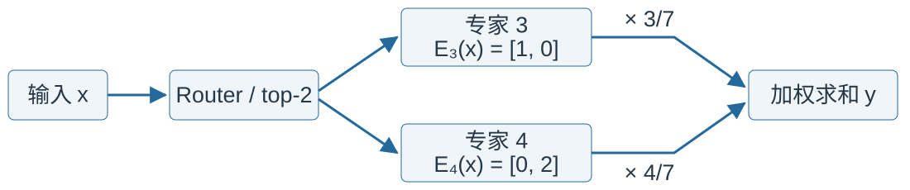

<style>
img[alt~="center"] {
  display: block;
  margin: 0 auto;
}
a[href='red'] {
    color: red;
    pointer-events: none;
    cursor: default;
    text-decoration: none;
}
</style>

<style>
img[alt~="right"] {
  display: block;
  margin:auto;
}
a[href='red'] {
    color: red;
    pointer-events: none;
    cursor: default;
    text-decoration: none;
}
</style>


# **LLM智能应用开发**

第8讲: 大语言模型解析 V
基于HF LlaMA实现的讲解

MoE, LoRA, 数的精度


<!-- https://marp.app/ -->

---

## LLM结构的学习路径

* LLM结构解析(开源LlaMA)
* 自定义数据集构造
* 自定义损失函数和模型训练/微调

---

## Transformer经典结构

<!--  -->


* Encoder-decoder结构
* 输入部分
  * Input embedding
  * Positional embedding
* Transformer部分
  * Feed forward network
  * Attention module
    * Flash Attention

---

## Transformer经典结构

<!--  -->


* Others
  * Transformers结构改动（参数方向）
    * Mixture-of-experts (MoE)
    * Low-rank adaptation (LoRA)
  * 数的精度
    * 浮点数
      * FP32, FP16, BF16, FP8
    * 整型
      * 量化初初步介绍


---


## Mixer-of-Experts (MoE)

* 从分而治之的思想说起
  * 术业有专攻：将问题拆分为多个子问题，每个子问题有自己的专家
    * 如何备战高考：语文、数学、英语、物理、化学...
* 模型中的“专家”
  * 问题：用户输入
  * 子问题：用户输入涉及什么类型
  * 专家：针对子问题的模型
    * ensemble视角：多个“一般”的模型
  * 选择专家：通过gating model/network选择最适合的专家
---

## Example of mixture of experts

图片来源[Ensemble Methods](https://amzn.to/2XZzrjG)


---

## NLP模型中的Mixture of experts


[Outrageously Large Neural Networks: The Sparsely-Gated Mixture-of-Experts Layer](https://arxiv.org/abs/1701.06538)
* 设计了MoE layer
  * 特点：稀疏(sparsely)、快速推理

<div style="display:contents;" data-marpit-fragment>


</div>

---

## MoE中的稀疏


---

## MoE中的稀疏

* 模型体积
  * 单expert尺寸为$s$
* 计算开销
  * 单expert的计算开销记为$c$
* 传统模型/单expert：体积$s$，计算开销$c$
* Sparsely MoE($M$个expert)，通过Gating network，选择最适合的expert进行推理计算
  * 模型体积：$M$个expert的MoE layer体积$Ms$
  * 计算开销：选择一个expert的情况下，计算开销为$c$

---

## MoE中的稀疏

不“怎么”增加模型计算开销的情况下，提升模型的体积

模型总参数量不变的情况下，降低每次推理的计算开销（所用参数）

<!--  -->

---

## MoE结构示例

* 一种"weighted multiplication"
  * 其中$G(x)$为gating network(可学习)，$E_i(x)$为expert
  * $y=\sum_{i=1}^nG(x)_iE_i(x)$

* $G(x)$通常为$\text{softmax}$，配以可学习的参数$W_g$
  * $G(x)=\text{softmax}(x\cdot W_g)$
* 为了体现稀疏性，一般选Top-k Gating
  * 通常　$k=1,2$
---

## MoE与Transformers

[Switch Transformers](https://arxiv.org/abs/2101.03961)将Transformers中的FFN替换为MoE结构


---

## MoE与Transformers

* [Switch Transformers](https://arxiv.org/abs/2101.03961)
  * T5-based MoEs going from 8 to 2048 experts
* [Mixtral 8x7B](https://huggingface.co/mistralai) 
  * 8 experts（每次激活2个）

---

#### 主流MoE模型的experts数量

| 模型（点击查看官方配置） | 路由专家 | 每 token 选中 | 共享专家 |
| --- | ---: | ---: | ---: |
| [DeepSeek-V4.1-Flash](https://huggingface.co/deepseek-ai/DeepSeek-V4.1-Flash/blob/main/inference/config.json) | 384 | 6 | 1 |
| [Qwen3.5-397B-A17B](https://huggingface.co/Qwen/Qwen3.5-397B-A17B) | 512 | 10 | 1 |
| [Kimi-K2.5](https://huggingface.co/moonshotai/Kimi-K2.5/blob/main/config.json) | 384 | 8 | 1 |
| [GLM-5.3](https://huggingface.co/zai-org/GLM-5.3/blob/aca966e4e02791568aa6a4ced368624b3d897f42/config.json) | 256 | 8 | 1 |
| [MiniMax-M2.7](https://huggingface.co/MiniMaxAI/MiniMax-M2.7/blob/main/config.json) | 256 | 8 | — |

<small>按单个 MoE 层统计；共享专家不计入 top-k。— 表示官方配置未列出共享专家。数据核对：2026 年 11 月。</small>


---

## MoE模型命名：总参数、激活参数与top-k

<style scoped>
section { font-size: 29px; }
h2 { font-size: 40px; }
table { font-size: 27px; }
p, ul { margin-top: 0.4em; margin-bottom: 0.4em; }
</style>

* **B = Billion（十亿）**；以 [Qwen3.5-397B-A17B](https://huggingface.co/Qwen/Qwen3.5-397B-A17B) 为例：

| 标记 | 名称 | 含义 |
| --- | --- | --- |
| 397B | 总参数量 | 模型共有约 3970 亿参数 |
| A17B | 每 token 激活参数量 | Active：每个 token 前向使用约 170 亿参数 |
| top-k = 10 | 每层选中的路由专家数 | 从 512 个路由专家中选 10 个，另有 1 个共享专家 |

* **Mixtral 8×7B**：每个 MoE 层有 8 个专家，top-k = 2；7B 是规模标记，不能按 8 个完整 7B 模型相乘估算总参数
* 激活参数包含该 token 使用的专家及共享部分；其数量不等于总权重存储量
* **A17B 的 A = Active（参数量）**；**W4A16 的 A = Activations（激活位宽）**

<!-- 来源：Qwen 官方模型卡 https://huggingface.co/Qwen/Qwen3.5-397B-A17B ，Model Overview：397B total、17B activated，512 routed experts，10 routed + 1 shared activated。Mixtral 官方说明 https://mistral.ai/news/mixtral-of-experts/ ：每层 8 个专家、每 token 选 2 个，总参数 46.7B，激活参数 12.9B。参数量为官方近似统计；激活参数包含被执行的 Attention 等共享模块，不能直接用总参数乘 top-k/专家数估算。 -->

---

## 如何确定MoE中的expert

* 通过训练过程学习参数，确定每个expert
* 以Mixtral 8x7B为例
  * 将FFN layer扩展为8个expert
    * 每个expert为原有尺寸的一个FFN layer
    * 通过Gating network选择最适合的expert


---


## 前馈神经网络(FFN)


---

## 标准FFN实现

```python
(mlp): LlamaMLP(
  (gate_proj): Linear(in_features=2048, out_features=8192, bias=False)
  (up_proj): Linear(in_features=2048, out_features=8192, bias=False)
  (down_proj): Linear(in_features=8192, out_features=2048, bias=False)
  (act_fn): SiLU()
)
```
* 默认包含Gate projection:
  * self.down_proj(self.act_fn(self.gate_proj(x)) * self.up_proj(x)

---

## MoE代码示例：Gating Network

```python
import torch
import torch.nn as nn

class TopKGating(nn.Module):
    def __init__(self, hidden_dim, num_experts, k=2):
        super().__init__()
        self.router = nn.Linear(hidden_dim, num_experts, bias=False)
        self.k = k

    def forward(self, x):
        scores = self.router(x)                         # [batch, experts]
        topk_scores, topk_idx = torch.topk(scores, self.k, dim=-1)
        probs = torch.softmax(topk_scores, dim=-1)
        gate = torch.zeros_like(scores)
        gate.scatter_(-1, topk_idx, probs)
        return gate, topk_idx
```

* `router` 根据输入生成专家打分，通过`topk`仅保留稀疏激活
* `gate`中的概率用于加权专家输出，`topk_idx`决定调用哪些expert

---

## MoE前向例子：4个专家，选择2个

<style scoped>
section { font-size: 30px; }
h2 { font-size: 40px; }
p { margin-top: 0.4em; margin-bottom: 0.4em; }
ul { margin-top: 0.4em; margin-bottom: 0.4em; }
</style>

* 对一个 token，Router 的 softmax 概率为 $[0.1,0.2,0.3,0.4]$
* 选择专家 3、4，重新归一化：$g_3=3/7,\;g_4=4/7$



$$y=\frac{3}{7}[1,0]+\frac{4}{7}[0,2]=[3/7,8/7]$$

* 输入 $x$ 分发给被选专家，输出加权求和；专家 1、2 不计算该 token
<!-- 每个 token 独立选择；此例沿用前页“选中后 softmax”的路由方式。 -->

---

## MoE的训练

* 通过load balancing训练MoE
* MoE训练之前：初始化每个expert，且并无任何含义
* 不加任何控制的训练：每次选取top-k(=2)的expert进行训练和参数更新，容易使模型选择被训练的快的experts
* load balancing: 在训练过程中，赋予每个expert近乎相同数量的训练样本
  * DeepSeek-V3 通过共享专家与容量约束(capacity factor)等机制控制路由均衡，因此并未额外引入Switch Transformer式的auxiliary loss


---

## Low-rank adaptation (LoRA)

* 一种流行的轻量级LLM微调技术
  * 通过很少的trainable parameters,快速微调LLM
    * [LoRA: Low-Rank Adaptation of Large Language Models](https://arxiv.org/abs/2106.09685)


<div style="display:contents;" data-marpit-fragment>


</div>

---

## LoRA基本思路

* 传统的training和finetuning
  * $W_{updated}=W_{old}+\Delta W$
    * $\Delta W$ size: [4096, 4096]
* LoRA
  * $\Delta W \approx AB$, rank $r$=8 (可调)
    * $A$ size: [4096, 8]
    * $B$ size: [8, 4096]
  * $W_{updated}\approx W_{old}+\alpha AB$
    * $\alpha$: scaling factor

---

## LoRA推理

* 传统的training和finetuning后的推理过程
  * $x\cdot W_{updated} = x\cdot (W_{old}+\Delta W)=x\cdot W_{old}+ x\cdot \Delta W$
* LoRA推理
  * $x\cdot W_{updated} \approx x\cdot (W_{old}+AB)=x\cdot W_{old}+ x\cdot \alpha AB$


---

## LoRA实现

```python
import torch.nn as nn

class LoRALayer(nn.Module):
    def __init__(self, in_dim, out_dim, rank, alpha):
        super().__init__()
        std_dev = 1 / torch.sqrt(torch.tensor(rank).float())
        self.A = nn.Parameter(torch.randn(in_dim, rank) * std_dev)
        self.B = nn.Parameter(torch.zeros(rank, out_dim))
        self.alpha = alpha

    def forward(self, x):
        x = self.alpha * (x @ self.A @ self.B)
        return x
```

---


## LoRA实现

```python
class LinearWithLoRA(nn.Module):

    def __init__(self, linear, rank, alpha):
        super().__init__()
        self.linear = linear
        self.linear.requires_grad_(False)  # 冻结基座，只训练 LoRA
        self.lora = LoRALayer(
            linear.in_features, linear.out_features, rank, alpha
        )

    def forward(self, x):
        return self.linear(x) + self.lora(x)
```


---

## LoRA例子：参数量与初始化

<style scoped>
section { font-size: 30px; }
h2 { font-size: 40px; }
table { font-size: 28px; }
</style>

* 沿用前页：$W\in\mathbb{R}^{4096\times4096}$，$A\in\mathbb{R}^{4096\times8}$，$B\in\mathbb{R}^{8\times4096}$

| 更新方式 | 可训练参数量（不计 bias） |
| --- | ---: |
| 完整微调 $W$ | $4096^2=16,777,216$ |
| 仅训练 $A,B$ | $4096\times8+8\times4096=65,536$，为前者的 $1/256$ |

* 随机初始化 $A$，令 $B=0$：$xW+\alpha xAB=xW$，初始输出与基座一致
* 第一次反向时 $A$ 的梯度为零；$B$ 通常能获得梯度，更新后 $A$ 也可学习
* 基座需显式冻结；节省的是可训练参数及相关状态，基座权重仍需存储

<!-- 本页沿用原课件的行向量约定和 alpha（有效缩放系数）；标准 LoRA 常将该系数写为 alpha/r。A 的首次梯度为零来自 B=0，B 梯度是否非零取决于输入和上游梯度。 -->

---

## 浮点数表示

* 浮点数，又称floating point，是一种有符号的二进制数，考虑其精度(Precision)，通常有：
  * 双精度: FP64
  * 单精度: FP32
  * 半精度: FP16

<div style="display:contents;" data-marpit-fragment>


</div>

---

## 浮点数表示

* 以FP32为例:
  * 符号位: 1位 sign
  * exponent部分: 8位 exponent 
  * fraction部分: 23位 fraction
  * $value=(-1)^{\text{sign}}\times2^{E-127}\times(1+\sum_{i=1}^{23}b_{23-i}2^{-i})$

<div style="display:contents;" data-marpit-fragment>


</div>

---

## 浮点数表示


---

## 浮点数表示


---

## 浮点格式对比

| 格式 | 尾数 | 指数 | 近似数值范围 | 常见场景 |
| --- | --- | --- | --- | --- |
| FP32 | 23 | 8 | 1.18e-38 ~ 3.4e38 | 全精度训练、关键评估 |
| BF16 | 7 | 8 | 1.18e-38 ~ 3.4e38 | 大规模训练，保留 FP32 动态范围 |
| FP16 | 10 | 5 | 6.10e-5 ~ 6.55e4 | 混合精度训练、推理 |
| FP8 (E4M3 / E5M2) | 3 / 2 | 4 / 5 | 2.4e-2 ~ 4.48e2 / 5.96e-4 ~ 5.73e4 | 最新 GPU 上的高效推理/训练 |

---

## 浮点例子：范围与精度

<style scoped>
section { font-size: 30px; }
h2 { font-size: 40px; }
table { font-size: 28px; }
pre { font-size: 23px; }
</style>

| 输入 | 转成 FP16 后 | 转成 BF16 后 |
| --- | ---: | ---: |
| $1.001$ | $1.0009765625$ | $1.0$ |
| $70000$ | $+\infty$（溢出） | $70144$（舍入） |

```python
import torch
x = torch.tensor([1.001, 70000.0], dtype=torch.float32)
for dtype in (torch.float16, torch.bfloat16):
    print(dtype, x.to(dtype).float().tolist())
```

* FP16 在 1 附近更精细；BF16 的指数范围更大，可表示更大的有限数
* 转回 FP32 方便查看结果，但不能恢复低精度转换时丢失的信息

---

## 量化术语：WxxAyy 是什么意思？

<style scoped>
section { font-size: 29px; }
h2 { font-size: 40px; }
table { font-size: 27px; }
p, ul { margin-top: 0.4em; margin-bottom: 0.4em; }
</style>

* **W = Weights（权重）**，**A = Activations（激活张量）**；数字表示位数
* 在线性层 $Y=XW$ 中，W 对应参数 $W$，A 对应运行时输入 $X$；A 不是激活函数

| 术语 | 权重位宽 | 激活位宽 | 常见格式示例 |
| --- | ---: | ---: | --- |
| W16A16 | 16 bit | 16 bit | FP16 或 BF16 |
| W8A16 | 8 bit | 16 bit | 如 INT8 权重 + FP16/BF16 激活 |
| W4A16 | 4 bit | 16 bit | 如 INT4 权重 + FP16/BF16 激活 |
| W8A8 | 8 bit | 8 bit | 可采用 INT8 或 FP8，需注明格式 |

* **Weight-only（仅权重量化）**：如 W4A16，激活仍保留 16 位浮点表示
* 位宽不等于数值格式；这类简称不指定累加精度、输出精度或 KV cache 精度

<!-- 来源：NVIDIA Model Optimizer 官方量化配置 https://github.com/NVIDIA/Model-Optimizer/blob/main/modelopt/torch/quantization/config.py 及官方支持列表 https://github.com/NVIDIA/Model-Optimizer/blob/main/docs/source/guides/0_support_matrix.rst 。位宽描述适用于所配置的量化层，并不保证所有模块都采用同一精度；W4A16 的低位宽权重通常在内核中转换后参与运算，不能据此认定乘加使用 INT4。 -->

---

## 精度与量化衔接

* 动态范围越大，越能容忍梯度与激活的波动（如 BF16 对比 FP16）
* 尾数位数越多，保留的有效精度越高（FP16 在小数部分优于 BF16）
* 常见流程：混合精度训练（BF16/FP32）→ 推理阶段量化（INT8/INT4）
  * INT8：服务器推理主流选择，兼顾吞吐与精度
  * INT4：边缘/移动部署，需配合蒸馏或量化感知训练
* 组合策略：依据模型规模、硬件指令支持与误差容忍度，混用浮点与整型格式

---

## 混合精度示意

 

---

## 量化的核心思路

* 把浮点权重与激活压缩到较小的整数范围（如 INT8/INT4），降低显存与带宽占用
* 常见做法：为张量或通道学习缩放因子 `scale` 和零点 `zero_point`
  * 映射公式：`x_q = round(x/scale + zero_point)`
  * x_q: 量化后数值
  * scale: 缩放因子，fp32
  * zero_point：零点，表示在浮点数域中值为 0 时，对应的 int8 整数值。

---

## 量化示意


<!-- * 位宽越低误差越大，可配合蒸馏、RPTQ 等手段补偿
* 整数矩阵乘法在 GPU/ASIC 上通常吞吐更高、能耗更低 -->

<!-- ---

## 常见量化方式

| 策略 | 说明 | 典型场景 |
| --- | --- | --- |
| Post-Training Quantization (PTQ) | 模型训练完成后离线量化，依赖小规模校准数据 | 快速上线、推理加速 |
| Quantization-Aware Training (QAT) | 训练阶段插入假量化节点，显式模拟量化误差 | 对精度敏感或降 bit 较激进的任务 |
| Weight-Only INT8/INT4 | 仅量化权重、激活保持 FP16/BF16 | 服务器侧 LLM.int8() / AWQ |
| Activation-Aware Quantization | 权重和激活一起量化，需处理 KV cache 与注意力输出 | 移动端/边缘部署、极致压缩 | -->
